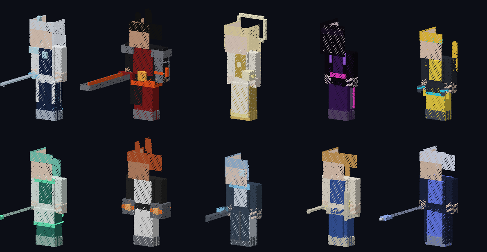

# NOCTERRA / 녹테라

A character-collecting action RPG that runs on Minecraft Bedrock Edition. It has a 4-character party with live switching, 6 elements with reactions, Break, Perfect Dodge, QTE switch attacks, a gacha with pity and a 50/50 guarantee, and saves that persist across restarts. It is built touch-first (Android, Galaxy Z Fold) on the stable Script API.

```
behavior_pack/NOCTERRA_BP   gameplay pack (items, entities, bundled scripts/main.js)
resource_pack/NOCTERRA_RP   visuals: textures, geometry, animations, lang (placeholders = REPLACE_ME)
scripts/                    TypeScript source (modular systems, see docs/ARCHITECTURE.md)
database/                   all game content as JSON (characters, weapons, banners, enemies, quests, world)
tools/                      build, asset generation, validation
tests/                      unit tests + end-to-end vertical-slice simulations
docs/                       design + technical docs
builds/                     packaged .mcaddon output
```

## Quick start

```bash
npm install
npm run check        # typecheck + validate + tests + build
npm run package      # → builds/NOCTERRA_v<version>.mcaddon
```

Install the `.mcaddon`, enable both packs on a world (no experimental toggles needed), and join. Full server setup is in [docs/BUILD.md](docs/BUILD.md).

## Status: v1.0.1 (real-device stabilization)

All checks are simulation- and static-verified. **Not yet verified on a device**, so start with [docs/DEVICE_TEST.md](docs/DEVICE_TEST.md). Audit: [docs/AUDIT_1.0.1.md](docs/AUDIT_1.0.1.md).

### 1.0.0 summary

All 10 characters are playable with their own 3D silhouettes, animations and ultimate cinematics. The full Chapter 1 runs end to end, and the gacha, progression, dungeons, bosses, co-op, exploration and the mobile/Fold UI are all in place. Vertical Slices A, B and C plus UI QA pass in the simulated engine. It has not yet been run on a physical device. See [CHANGELOG.md](CHANGELOG.md) and [docs/AUDIT.md](docs/AUDIT.md).



## Docs
[AUDIT](docs/AUDIT.md) · [ART_DIRECTION](docs/ART_DIRECTION.md) · [ARCHITECTURE](docs/ARCHITECTURE.md) · [GAME_DESIGN](docs/GAME_DESIGN.md) · [CHARACTERS](docs/CHARACTERS.md) · [COMBAT](docs/COMBAT.md) · [GACHA](docs/GACHA.md) · [UI](docs/UI.md) · [SAVE_FORMAT](docs/SAVE_FORMAT.md) · [BUILD](docs/BUILD.md) · [TESTING](docs/TESTING.md) · [REPLACE_ME](docs/REPLACE_ME.md)
